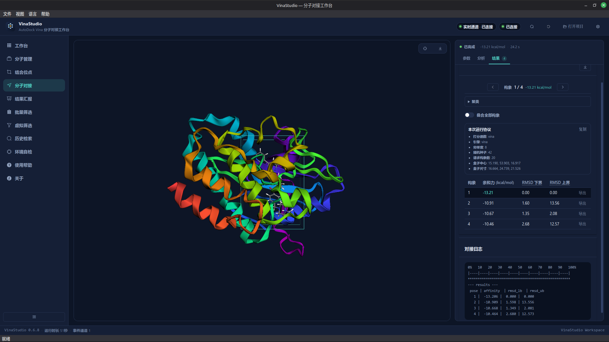
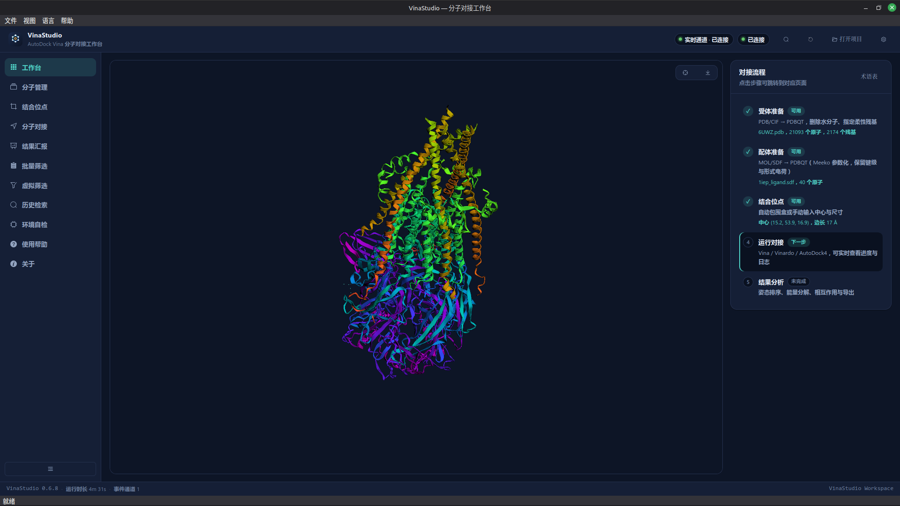
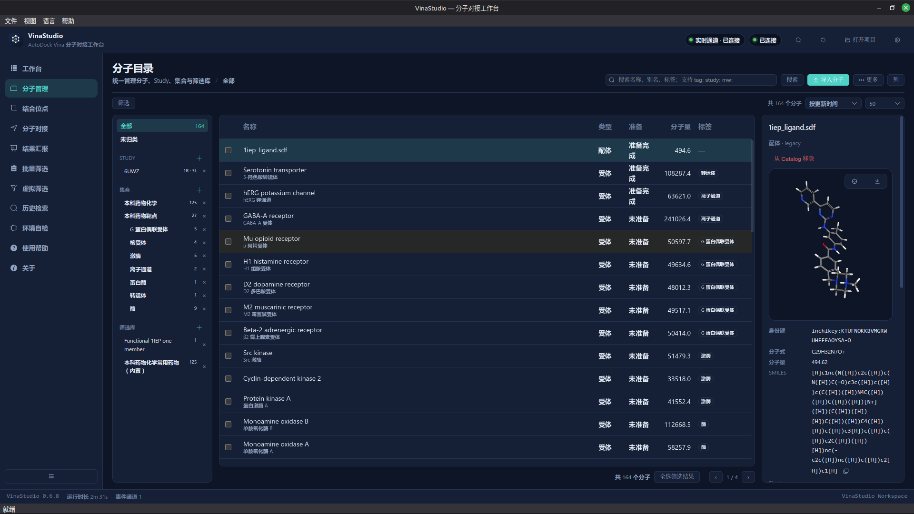
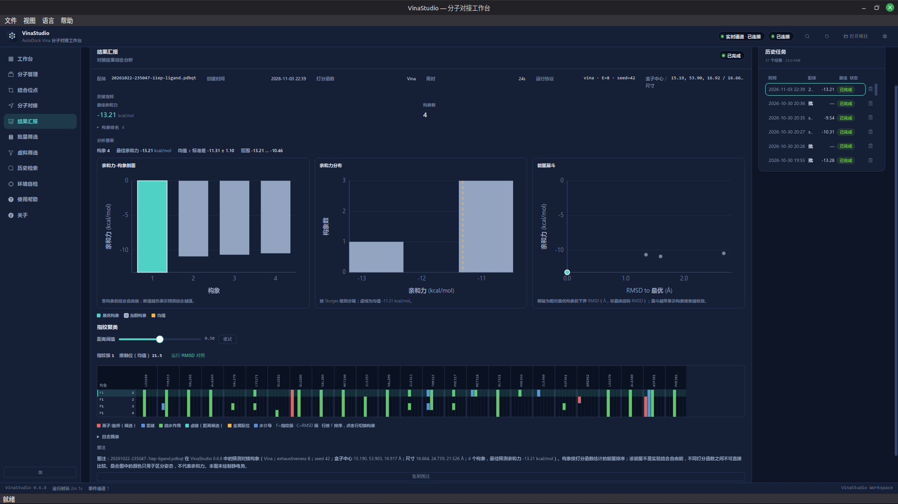
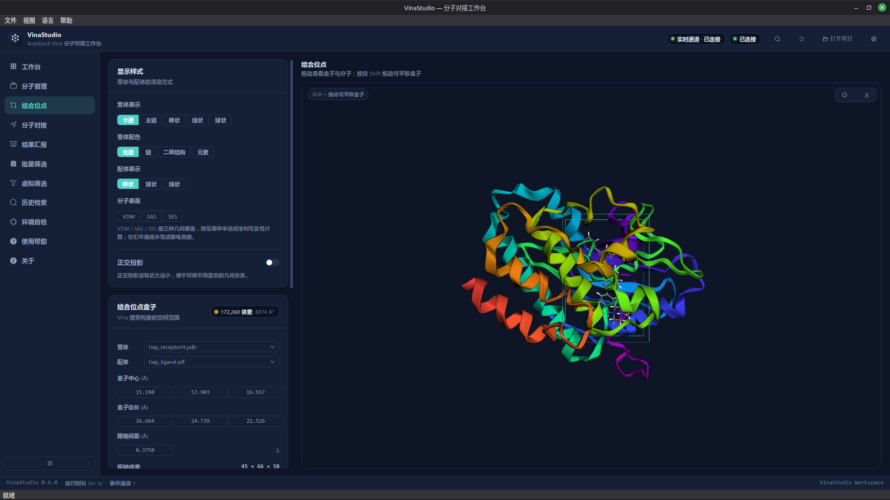

# VinaStudio

**English** · [简体中文](README.md)

[](https://github.com/hubehero/VinaStudio/releases)
[](LICENSE)
[](#install-and-run)
[](https://github.com/ccsb-scripps/AutoDock-Vina)

**A local desktop workbench for the complete AutoDock Vina workflow.** Prepare
receptors and ligands, define the binding site, run Vina/Vinardo/AutoDock4,
inspect poses and interactions, and keep the parameters and results of every
run together in one window.



## Why VinaStudio

AutoDock Vina is reliable, but its command line and Python API are awkward for
repeating the same preparation, inspection and review cycle. VinaStudio keeps
those steps in one interface you can return to:

- **No hand-written command sequences** — receptor, ligand, box and job
  parameters are set in the application.
- **Traceable results** — jobs keep their parameters, input hashes, duration
  and logs, and can be reviewed after a restart.
- **Honest science** — docking scores are model predictions, not experimental
  free energies; the validation records state the supported scope.
- **Local core** — preparation, docking and analysis run on the machine;
  online compound search is optional and sends only the query to its provider.

## What it does

- **Preparation** — PDB/mmCIF → PDBQT; MOL/SDF/MOL2/SMILES → 3D PDBQT via Meeko.
- **Binding site** — derive the box from a ligand or residue selection, or enter
  its centre and size manually and edit it in 3D.
- **Docking** — Vina, Vinardo and AutoDock4, with live stage progress, streamed
  logs and real cancellation.
- **Analysis** — pose ranking, per-pose energy decomposition, redocking RMSD,
  geometry checks, and 2D/3D interaction maps.
- **Organisation** — a Catalog for receptors, ligands, Studies, collections and
  screening libraries, with 125 built-in teaching drugs.
- **Review and export** — CSV, poses, self-contained HTML reports and project
  files; searchable history with favourites, tags and comparison.

## Screenshots

<table>
  <tr>
    <td width="50%" align="center">
      <br>
      <sub>Workbench: one pipeline</sub>
    </td>
    <td width="50%" align="center">
      <br>
      <sub>Catalog: one place for inputs</sub>
    </td>
  </tr>
  <tr>
    <td width="50%" align="center">
      <br>
      <sub>Results: charts and run protocol</sub>
    </td>
    <td width="50%" align="center">
      <br>
      <sub>Binding site: confirm the box in 3D</sub>
    </td>
  </tr>
</table>

## Install and run

| Platform | What is available |
|---|---|
| Linux x86_64 | `.deb` or portable tarball |
| Windows 10 1809+ / 11 x64 | Installer; built by CI, unsigned |
| macOS | Source only; not packaged or release-verified |

Download the Windows installer and `SHA256SUMS` from
[Releases](https://github.com/hubehero/VinaStudio/releases). The installer is
per-machine (administrator required) and unsigned, so SmartScreen will ask for
confirmation. It bundles Python, the scientific stack and the AutoDock Vina
1.2.7 command-line engine; no separate Python, uv, Node.js or pnpm is needed.

The supported surface and its limits (AutoDock4 maps, antialiasing default,
x64 only, no auto-update) are documented in [Windows support](docs/WINDOWS.md).

### Linux

Download the `.deb` or portable tarball from Releases. Install the package with
`sudo apt install ./vinastudio_<version>_amd64.deb`, or unpack the tarball and
run `vinastudio/vinastudio`.

### From source

You need Python 3.12, [uv](https://docs.astral.sh/uv/), Node.js 22+ and
[pnpm](https://pnpm.io/).

```bash
pnpm -C web install
pnpm -C web build            # build the SPA into vinastudio/server/static first
uv sync --extra dev
uv run python -m vinastudio
```

`scripts/build_web.py` wraps the interface build. Installation and
troubleshooting details are in the [user guide](docs/USER_GUIDE.md).

## Five-minute 1IEP trial

1. Open the application and click **Set up the 1iep example** on the Workbench.
2. Confirm the receptor, ligand and automatic box, then open **Docking**.
3. Keep the default Vina, exhaustiveness 8 and 20 poses; click **Start docking**.
4. Review the pose table, energy decomposition and interactions; open
   **Results report** to inspect the parameters and charts.

1IEP is a software control, not a general docking-accuracy claim. More examples
are in the [user guide](docs/USER_GUIDE.md).

## Validation and limits

Validation records ship with the code, not just a screenshot:

- **1IEP redocking control** — top-pose RMSD **0.353 Å**, best affinity
  **−13.286 kcal/mol**, 5 poses, 0 geometry errors.
- **12 pre-registered open targets × 5 seeds** — **60/60 passed**, mean top-1
  RMSD **0.5343 Å**, bootstrap 95% CI **[0.4710, 0.6020] Å**.
- **Official PoseBusters 0.6.5** (`redock`, same preparation as docking) —
  top pose **60/60**, all poses **7/60**.

These results apply only to that pre-registered open set and protocol. They are
not PDBbind/CASF, a universal accuracy claim, an enrichment claim or an
experimental-affinity claim. Protocols, failures and raw reports are linked from
[Academic validation](docs/ACADEMIC_VALIDATION.md) and the
[benchmark record](validation/benchmark/records/2026-11-02-open-posebusters-v1/).

## Architecture

Four layers with strict boundaries:

| Layer | Location | Responsibility |
|---|---|---|
| Desktop shell | `vinastudio/desktop/` | Qt window, native menus, QWebChannel bridge |
| API | `vinastudio/server/` | FastAPI on loopback, serves the SPA, streams job events over WebSocket |
| Domain core | `vinastudio/core/` | Docking, preparation and analysis; no Qt or FastAPI dependency |
| Interface | `web/` | Vue 3 + 3Dmol.js SPA |

Three constraints shape the rest: the interface is served over **local HTTP**
(never `file://`); docking runs in **spawned child processes** (Vina has no
cancellation API); and **PDBQT is never rendered directly** (Meeko converts
poses to SDF). See [Architecture](docs/ARCHITECTURE.md).

## Documentation

- [User guide](docs/USER_GUIDE.md) · [简体中文](docs/USER_GUIDE.zh-CN.md)
- [Documentation index](docs/README.md) · [Windows support](docs/WINDOWS.md)
- [Academic validation and limits](docs/ACADEMIC_VALIDATION.md)
- [Validation method and reproduction](docs/VALIDATION.md)
- [Changelog](CHANGELOG.md) · [Contributing](CONTRIBUTING.md) ·
  [Security](SECURITY.md)

## Development

These commands need the development tree; the public release tree does not
include the test suite or `scripts/dev.py`.

```bash
uv run python scripts/dev.py   # API + Vite + Qt with hot reload
./web_start.sh                 # web interface only, for browser testing
uv run pytest -q               # backend tests
uv run ruff check .
pnpm -C web typecheck
```

## Community

- Questions and bugs: [GitHub Issues](https://github.com/hubehero/VinaStudio/issues)
- Contributions: [CONTRIBUTING.md](CONTRIBUTING.md)
- Conduct: [CODE_OF_CONDUCT.md](CODE_OF_CONDUCT.md)
- Security: report privately as described in [SECURITY.md](SECURITY.md); do not
  open a public issue with exploit details.

## License and acknowledgements

The code is **MIT**-licensed; see [LICENSE](LICENSE) and
[THIRD_PARTY_LICENSES.md](THIRD_PARTY_LICENSES.md).

Core dependencies and references: [AutoDock Vina](https://github.com/ccsb-scripps/AutoDock-Vina)
(Apache-2.0), [Meeko](https://github.com/forlilab/Meeko) (LGPL-2.1),
[RDKit](https://www.rdkit.org/) (BSD-3-Clause),
[3Dmol.js](https://3dmol.csb.pitt.edu/) (BSD-3-Clause),
[Vue 3](https://vuejs.org/) (MIT), [Element Plus](https://element-plus.org/)
(MIT), and [PySide6](https://doc.qt.io/qtforpython/) (LGPL-3.0).
