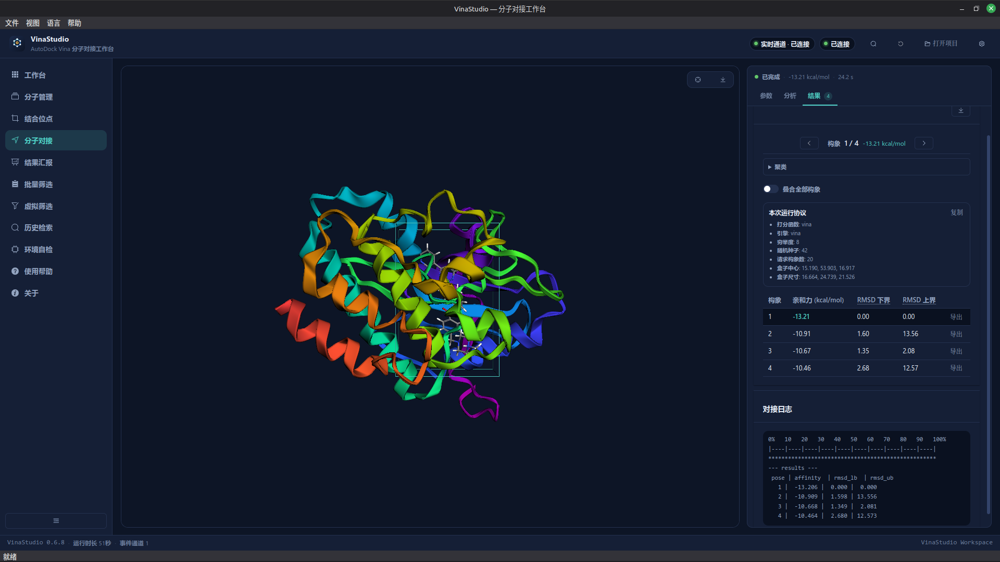
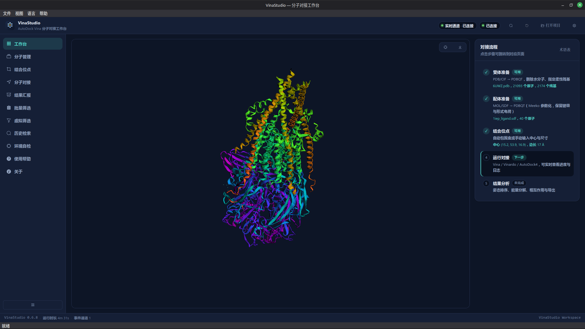
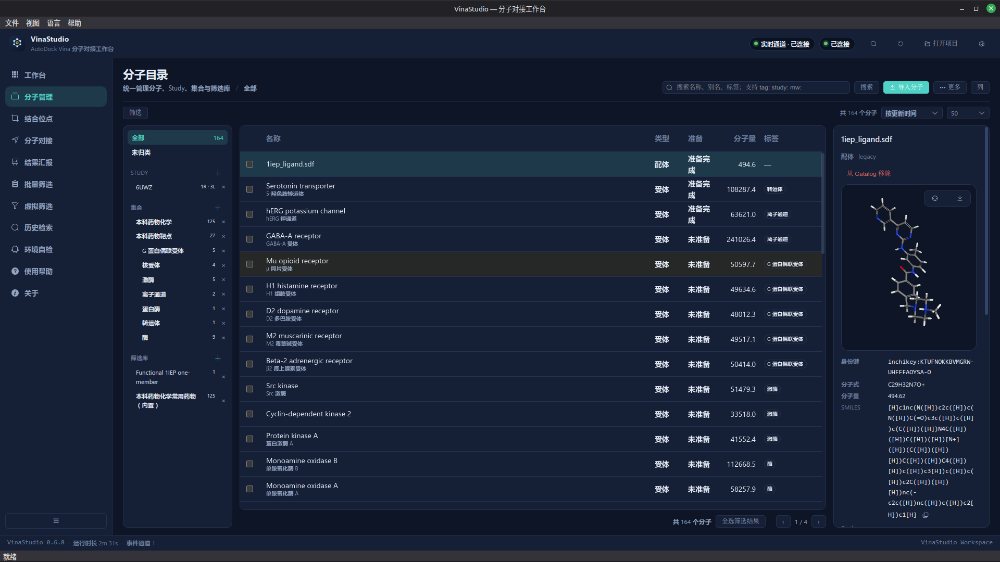
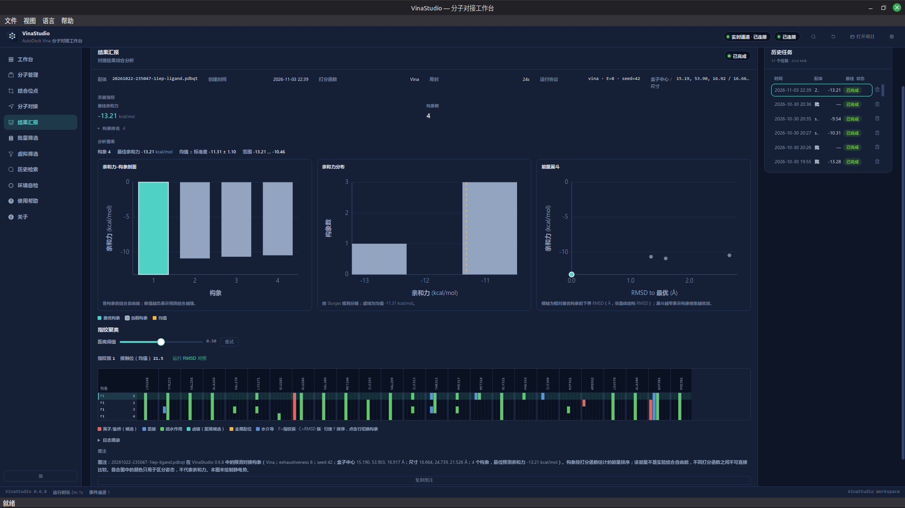
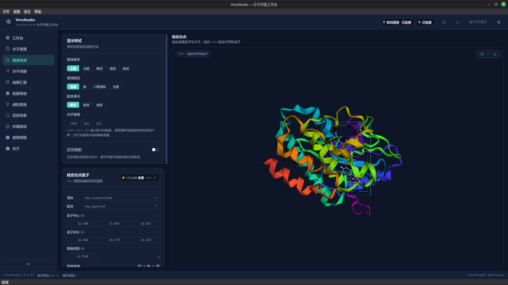

# VinaStudio

**简体中文** · [English](README.en.md)

[](https://github.com/hubehero/VinaStudio/releases)
[](LICENSE)
[](#安装与运行)
[](https://github.com/ccsb-scripps/AutoDock-Vina)

**一个把 AutoDock Vina 的完整工作流放进桌面的本地工具。** 在同一个窗口里准备
受体和配体、定义结合位点、运行 Vina/Vinardo/AutoDock4、检查构象与相互作用，
并把每次运行真正使用的参数和结果一起保存下来。



## 为什么用它

AutoDock Vina 很可靠，但命令行与 Python API 都不适合反复做同一套准备、检查和
复盘。VinaStudio 让这些步骤留在同一个可回看的界面里：

- **不用手写每条命令**：受体、配体、盒子和任务参数都在界面里完成。
- **结果可追溯**：作业保存参数、输入哈希、运行时长和日志，重启后仍能回看。
- **科学口径清楚**：对接分数是模型预测，不是实验自由能；验证报告把适用范围写清楚。
- **核心计算在本地**：准备、对接和分析都在本机；在线化合物检索是可选项，
  只向对应数据库发送检索词或结构。

## 能做什么

- **准备**：PDB/mmCIF → PDBQT；MOL/SDF/MOL2/SMILES → 3D PDBQT，使用 Meeko。
- **定义位点**：从配体或残基自动推导盒子，也可以手动输入中心与尺寸，并在 3D 中编辑。
- **对接**：Vina、Vinardo、AutoDock4；实时阶段进度、日志和真正的取消。
- **分析**：姿态排名、逐姿态能量分解、Redocking RMSD、几何体检、2D/3D 相互作用图。
- **管理**：Catalog 统一管理受体、配体、Study、集合和筛选库；125 个内置教学药物开箱即用。
- **导出与复盘**：CSV、pose、结果 HTML、项目文件；历史检索支持收藏、标签和比较。

## 界面

<table>
  <tr>
    <td width="50%" align="center">
      <br>
      <sub>工作台：一条流程走完</sub>
    </td>
    <td width="50%" align="center">
      <br>
      <sub>分子目录：统一管理输入</sub>
    </td>
  </tr>
  <tr>
    <td width="50%" align="center">
      <br>
      <sub>结果汇报：看图，也看协议</sub>
    </td>
    <td width="50%" align="center">
      <br>
      <sub>结合位点：在 3D 里确认盒子</sub>
    </td>
  </tr>
</table>

## 安装与运行

| 平台 | 可用形式 |
|---|---|
| Linux x86_64 | `.deb` 或便携 tar.gz |
| Windows 10 1809+ / 11 x64 | 安装包；CI 构建，安装包未签名 |
| macOS | 仅源码运行，未做发布级验证 |

Windows 安装包与 `SHA256SUMS` 从
[Releases](https://github.com/hubehero/VinaStudio/releases) 下载。安装器需要
管理员权限，首次运行会触发 SmartScreen；内置 Python、科学计算栈、Vina 1.2.7
命令行引擎，不需要另装 Python、uv、Node.js 或 pnpm。

Windows 的边界（AutoDock4 地图、抗锯齿默认值、只支持 x64、无自动更新）见
[Windows 支持](docs/WINDOWS.zh-CN.md)。

### Linux

从 Releases 下载 `.deb` 或便携 tar.gz。`.deb` 用
`sudo apt install ./vinastudio_<版本>_amd64.deb` 安装；tarball 解压后运行
`vinastudio/vinastudio`。

### 从源码运行

需要 Python 3.12、[uv](https://docs.astral.sh/uv/)、Node.js 22+ 与
[pnpm](https://pnpm.io/)。

```bash
pnpm -C web install
pnpm -C web build            # 先构建界面，生成 vinastudio/server/static
uv sync --extra dev
uv run python -m vinastudio
```

`scripts/build_web.py` 封装了界面构建步骤。源码运行与开发环境的更多排障见
[用户手册](docs/USER_GUIDE.zh-CN.md)。

## 五分钟试用 1IEP

1. 打开应用，在 **工作台** 点 **一键准备 1iep 示例**。
2. 确认受体、配体与自动盒子，进入 **分子对接**。
3. 保持默认 Vina、exhaustiveness 8、20 poses，点击 **开始对接**。
4. 对接完成后查看姿态表、能量分解和相互作用；在 **结果汇报** 中复盘参数与图表。

1IEP 是软件控制样例，不代表通用对接准确率。更多示例见
[用户手册](docs/USER_GUIDE.zh-CN.md)。

## 验证与可信度

验证记录随代码一起发布，并不只是一张成功截图：

- **1IEP 重对接控制**：top pose RMSD **0.353 Å**，最佳亲和力
  **−13.286 kcal/mol**，5 poses，0 几何错误。
- **12 个预注册开放靶点 × 5 seeds**：**60/60 passed**，mean top-1 RMSD
  **0.5343 Å**，bootstrap 95% CI **[0.4710, 0.6020] Å**。
- **官方 PoseBusters 0.6.5**（`redock`，与 docking 相同的制备条件）：
  top pose **60/60**，全部 pose **7/60**。

这些结果只适用于对应的预注册开放集合与协议，不是 PDBbind/CASF、通用准确率、
富集或实验亲和力声明。验证协议、失败记录和原始报告见
[学术验证](docs/ACADEMIC_VALIDATION.zh-CN.md) 与
[基准记录](validation/benchmark/records/2026-11-02-open-posebusters-v1/)。

## 架构

四层，边界严格：

| 层 | 位置 | 职责 |
|---|---|---|
| 桌面外壳 | `vinastudio/desktop/` | Qt 窗口、原生菜单、QWebChannel 桥 |
| API | `vinastudio/server/` | 回环 FastAPI，托管 SPA，WebSocket 推送任务事件 |
| 领域核心 | `vinastudio/core/` | 对接、准备、分析；不依赖 Qt 或 FastAPI |
| 界面 | `web/` | Vue 3 + 3Dmol.js SPA |

三条约束决定其余设计：**本地 HTTP 提供界面**（不是 `file://`）；**对接在 spawn
子进程中运行**（Vina 没有取消 API）；**PDBQT 不直接渲染**（由 Meeko 转 SDF）。
详见 [架构文档](docs/ARCHITECTURE.zh-CN.md)。

## 文档

- [用户手册](docs/USER_GUIDE.zh-CN.md) · [English](docs/USER_GUIDE.md)
- [文档索引](docs/README.md) · [Windows 支持](docs/WINDOWS.zh-CN.md)
- [学术验证与限制](docs/ACADEMIC_VALIDATION.zh-CN.md)
- [验证方法与复现](docs/VALIDATION.md)
- [更新记录](CHANGELOG.md) · [贡献指南](CONTRIBUTING.zh-CN.md) ·
  [安全策略](SECURITY.zh-CN.md)

## 开发

以下命令需要开发树；公开 release tree 不包含测试套件和 `scripts/dev.py`。

```bash
uv run python scripts/dev.py   # API + Vite + Qt，热重载
./web_start.sh                 # 仅 Web 界面，浏览器测试
uv run pytest -q               # 后端测试
uv run ruff check .
pnpm -C web typecheck
```

## 社区

- 问题与缺陷：[GitHub Issues](https://github.com/hubehero/VinaStudio/issues)
- 贡献：[CONTRIBUTING.zh-CN.md](CONTRIBUTING.zh-CN.md)
- 行为准则：[CODE_OF_CONDUCT.zh-CN.md](CODE_OF_CONDUCT.zh-CN.md)
- 安全问题：按 [SECURITY.zh-CN.md](SECURITY.zh-CN.md) 私下报告，不要在公开
  issue 中贴利用细节。

## 许可与致谢

代码以 **MIT** 发布，见 [LICENSE](LICENSE)；第三方声明见
[THIRD_PARTY_LICENSES.md](THIRD_PARTY_LICENSES.md)。

核心依赖与参考：[AutoDock Vina](https://github.com/ccsb-scripps/AutoDock-Vina)
（Apache-2.0）、[Meeko](https://github.com/forlilab/Meeko)（LGPL-2.1）、
[RDKit](https://www.rdkit.org/)（BSD-3-Clause）、
[3Dmol.js](https://3dmol.csb.pitt.edu/)（BSD-3-Clause）、
[Vue 3](https://vuejs.org/)（MIT）、[Element Plus](https://element-plus.org/)
（MIT）、[PySide6](https://doc.qt.io/qtforpython/)（LGPL-3.0）。
